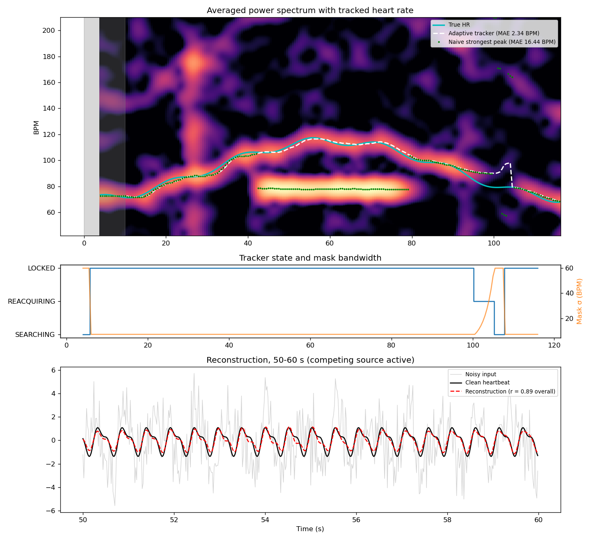
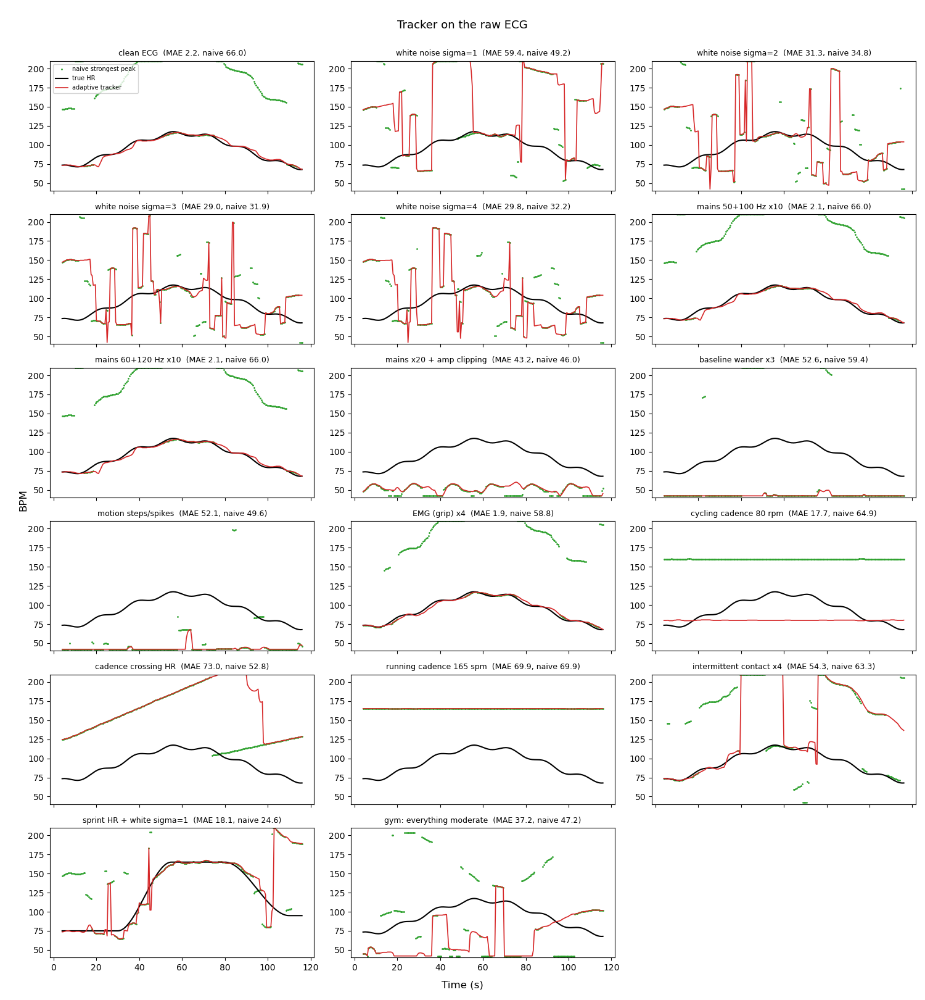
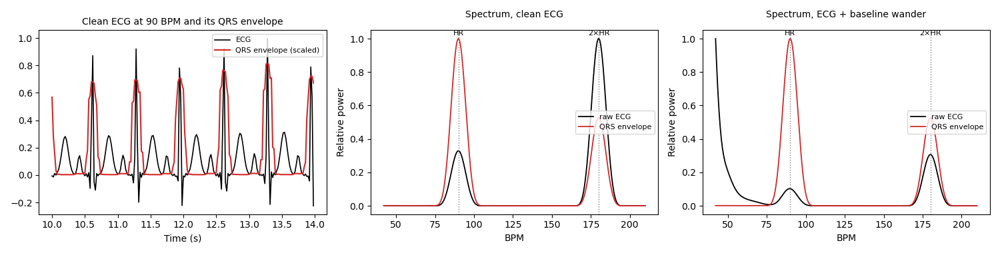
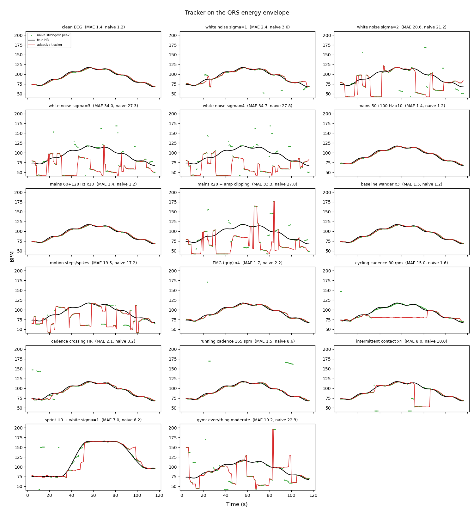
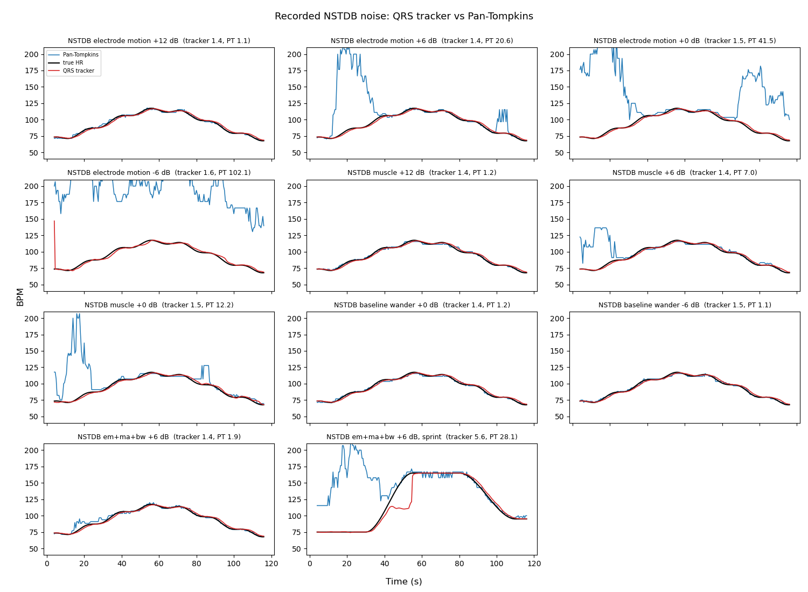

# BeatHunter

Finding and holding onto a heartbeat in a very noisy signal, using an FFT, a moving frequency mask and a bit of confidence-driven state.

This repo is a run-through of an idea: what I expected to work, what actually worked, what didn't, and why. Everything is tested on synthetic signals, so it says nothing yet about real-world accuracy.

**Short version.** Tracking a heart rate with an adaptive FFT mask works beautifully on a sine wave. It falls apart on a realistic ECG, because the beat is a sharp spike whose harmonics, plus any low-frequency junk, swamp the true rate. Tracking the *QRS energy envelope* instead fixes most noise types.

Against **real recorded noise** (the MIT-BIH Noise Stress Test Database), the QRS tracker stays within about 1.5 BPM down to 0 dB SNR. There, the classic **Pan–Tompkins** beat detector is off by 23–46 BPM. Averaging 8 s of beats in the frequency domain survives noise that hides individual beats.

Heavy broadband noise, amplifier clipping, a second rhythm passing through the heart rate, and fast heart-rate changes still beat it. The ECG itself is still synthetic and perfectly regular, which flatters a spectral method.

## The problem

Gym equipment such as treadmills, cross-trainers and bikes often has metal grips in the handles that read your heart rate. Holding one in each hand puts electrodes on your left and right arms, which is close to ECG **Lead I**. That lead is the potential difference across the heart, measured by a differential amplifier between the two hands.

That signal should be terrible:

- **Mains interference** at 50/60 Hz, plus 100/120 Hz from harmonics and flickering lighting. It's everywhere and often much bigger than the ECG itself.
- **Motion.** Hands slide, grip pressure changes and electrode contact comes and goes. Baseline wander and sudden steps follow.
- **Muscle noise (EMG)** from gripping the handles, and general broadband noise.
- **Competing rhythms.** Your stride or pedalling cadence sits at 1–3 Hz, right inside the heart-rate band.

So how would you identify a heartbeat in that?

## Step 1: the idea

A heart rate of 40–180 BPM is **0.67–3 Hz**. Find the peak in that band, then track it:

1. **FFT** a sliding window of the signal (about 8 s) and average the power spectrum over time, so random noise smooths out and persistent peaks build up.
2. **Search.** Look across the whole band for a peak that stays put for several frames. Check that it isn't a harmonic of a lower peak.
3. **Lock.** Once found, put a narrow mask (a Gaussian) around that frequency and pick the heart rate only from inside it. Real heart rates change smoothly, so limit how far the estimate can move per step.
4. **Update and repeat.** Re-centre the mask on the new estimate every frame.
5. **Don't panic.** If confidence drops for a moment, stay locked. If it stays low, **reacquire** by widening the mask gradually around the last estimate. Only fall back to a full search if that fails.
6. **Reconstruct** the heartbeat waveform by applying the mask to each frame's spectrum and inverse-FFTing.

| State       | Mask                                | Leaves when…                                             |
| ----------- | ----------------------------------- | -------------------------------------------------------- |
| Searching   | Whole band                          | a peak persists for several frames → Locked              |
| Locked      | Narrow, follows the estimate        | confidence stays low → Reacquiring                       |
| Reacquiring | Widens a little each frame          | confidence returns → Locked; mask fully wide → Searching |

Confidence is the peak power divided by the median power in the band, which is a simple peak SNR.

## Step 2: it works on a sine wave

`adaptive_heartbeat_tracker.py` tests this on a heartbeat modelled as a sine wave plus a weaker second harmonic. It adds heavy noise, a competing rhythm stronger than the heartbeat (40–78 s), two artifact bursts and a contact loss (95–104 s).



The tracker averages **2.3 BPM** error, against **16.4 BPM** for naively picking the strongest peak. The naive method jumps to the competing rhythm, while the locked mask ignores it.

The state panel shows the contact loss doing what it should. Confidence drops, the tracker drifts, the mask widens (REACQUIRING), it falls back to SEARCHING, and it locks on again a few seconds after contact returns.

**But a sine wave is the easy case.**

## Step 3: a realistic ECG breaks it

`noise_scenarios.py` replaces the sine with a QRS-shaped ECG (P, Q, R, S and T waves) sampled at 500 Hz. It adds one kind of noise per scenario, then anti-alias filters and decimates to 50 Hz, as a real front end would.



Except for mains noise and EMG, which are filtered out before tracking, nearly everything fails, including some cases that should be easy. The naive estimator is wrong even on a perfectly **clean** signal.

### Why



- **Harmonics.** A heartbeat is a sharp spike, not a sine wave. Its spectrum is a comb at HR, 2×HR, 3×HR and so on. How strong each tooth is depends on how the P, QRS and T waves line up with the beat interval. At 90 BPM (middle panel, black) the 2nd harmonic is three times stronger than the true rate. At 75 BPM the fundamental wins. So the "biggest peak" is the wrong answer at some heart rates and not others.
- **Low-frequency junk.** Breathing, baseline drift and electrode movement put far more energy into the bottom of the 0.67–3 Hz band than the heart does (right panel, black). The tracker gets dragged to the band floor and sits there.
- **Mains noise and EMG are fine.** They're far out of band and the anti-alias filter removes them. They only matter if they clip the amplifier.

## Step 4: track the QRS energy instead

Most of an ECG's energy is in the QRS complex, at roughly 5–20 Hz. The standard trick is to turn each beat into a single broad bump: band-pass to 5–20 Hz, square, then a 0.15 s moving average. That's the red trace in the left panel above.

The envelope's spectrum has a clear peak at the true rate, and the band-pass throws away the low-frequency junk entirely (middle and right panels, red). The tracker then runs on the envelope instead of the raw ECG.



Mean absolute error in BPM, mean of 5 seeds:

| Scenario                      | Naive, raw | Tracker, raw | Naive, QRS | Tracker, QRS |
| ----------------------------- | ---------: | -----------: | ---------: | -----------: |
| Clean ECG                     | 60.6 | 2.1  | 1.2  | **1.4**  |
| White noise σ=1               | 59.2 | 61.2 | 8.8  | **3.2**  |
| White noise σ=2               | 49.8 | 50.8 | 28.2 | 27.1     |
| Mains 50/60 Hz, ×10 the ECG   | 60.5 | 2.0  | 1.2  | **1.4**  |
| Mains ×20 with amp clipping   | 46.4 | 44.4 | 32.7 | 35.2     |
| Baseline wander ×3            | 63.2 | 42.3 | 1.2  | **1.4**  |
| Motion steps and spikes       | 47.2 | 46.7 | 23.7 | 25.3     |
| Grip EMG ×4                   | 60.7 | 1.9  | 3.0  | **1.6**  |
| Cycling cadence, 80 rpm       | 64.9 | 17.7 | 2.2  | 4.6      |
| Cadence sweeping through HR   | 52.5 | 78.1 | 3.8  | **2.0**  |
| Running cadence, 165 spm      | 69.9 | 69.9 | 9.3  | **1.5**  |
| Intermittent contact, 4 drops | 58.5 | 38.3 | 9.2  | **6.4**  |
| Sprint (75→165 BPM), σ=1      | 33.1 | 24.3 | 9.4  | **6.6**  |
| Everything at once            | 54.5 | 40.5 | 23.4 | 20.6     |

What changed:

- **The envelope does most of the work.** It turns a 60 BPM naive error into about 1 BPM on clean, mains, wander and EMG signals.
- **Tracking adds robustness on top.** When the signal is clean, picking the biggest envelope peak is already good enough. When there's noise, a competing rhythm or a contact loss, the lock and slew limit help. Running cadence improves from 9.3 to 1.5 BPM and white noise σ=1 from 8.8 to 3.2.

## Step 5: real noise, and an established baseline

Beating "pick the biggest peak" is a low bar, and invented noise models can flatter a method. So `noise_scenarios.py` adds two things.

**Recorded noise** from the [MIT-BIH Noise Stress Test Database](https://physionet.org/content/nstdb/1.0.0/) (NSTDB). Its three records are 30 minutes each of real ECG noise, recorded from active volunteers with electrodes placed where their own ECG isn't visible:

- **em:** electrode motion, the hardest kind, because it looks like beats;
- **ma:** muscle artifact;
- **bw:** baseline wander.

Random 2-minute segments are added to the synthetic ECG at a set SNR, using the database's own definition: signal power = (QRS peak-to-peak)²/8, noise power = mean square. `nstdb.py` downloads the records on first run into `data/nstdb/` and decodes PhysioNet's format directly, so no extra packages are needed.

**Pan–Tompkins** (1985), the classic real-time QRS detector, in `pan_tompkins.py`:

1. Band-pass 5–15 Hz, then differentiate, square and integrate over 150 ms.
2. Detect beats with adaptive thresholds, a 200 ms refractory period, T-wave rejection and searchback for missed beats.
3. Take heart rate from the median RR interval in the same 8 s window the tracker uses.

All methods see the same 50 Hz signal.



Mean absolute error in BPM, mean of 5 seeds, recorded NSTDB noise:

| Noise                          | Tracker, raw | Naive, QRS | Tracker, QRS | Pan–Tompkins |
| ------------------------------ | -----------: | ---------: | -----------: | -----------: |
| Electrode motion +12 dB        | 12.6 | 1.2  | **1.4**  | 3.1      |
| Electrode motion +6 dB         | 40.4 | 1.2  | **1.4**  | 12.6     |
| Electrode motion 0 dB          | 38.3 | 2.4  | **1.4**  | 46.3     |
| Electrode motion −6 dB         | 38.2 | 14.2 | 21.0     | 93.6     |
| Muscle +12 dB                  | 2.0  | 1.2  | **1.4**  | 2.6      |
| Muscle +6 dB                   | 13.3 | 1.2  | **1.4**  | 6.1      |
| Muscle 0 dB                    | 39.0 | 2.3  | **1.6**  | 23.2     |
| Baseline wander 0 dB           | 33.1 | 1.2  | **1.4**  | 2.8      |
| Baseline wander −6 dB          | 37.4 | 1.2  | **1.5**  | 3.4      |
| All three, +6 dB               | 25.2 | 1.2  | **1.4**  | 6.3      |
| All three, +6 dB, sprint       | 30.1 | 1.4  | 3.0      | 7.2      |

Pan–Tompkins on the synthetic scenarios ([chart](images/compare_synthetic.png)), against the QRS tracker:

| Scenario                     | Tracker, QRS | Pan–Tompkins |
| ---------------------------- | -----------: | -----------: |
| Clean, mains, wander, EMG    | 1.4–1.6      | 1.2–2.6      |
| White noise σ=1              | **3.2**      | 109.8        |
| Motion steps and spikes      | 25.3         | **6.5**      |
| Cycling cadence, 80 rpm      | **4.6**      | 41.9         |
| Running cadence, 165 spm     | **1.5**      | 96.7         |
| Intermittent contact         | **6.4**      | 18.4         |
| Everything at once           | **20.6**     | 101.8        |

What this shows:

- **Real noise confirms the QRS-envelope approach.** Down to 0 dB SNR, where the noise is as strong as the QRS, it stays within about 1.5 BPM for all three noise types. The raw-ECG tracker fails on the same noise, so the envelope is doing the work.
- **Spectral averaging beats beat-by-beat detection at low SNR.** Pan–Tompkins has to decide on every beat. Once noise peaks look as big as QRS peaks, it counts extra beats and the median RR roughly halves. That's why its errors approach the heart rate itself, and errors above 100 BPM mean it's reading roughly double. The FFT tracker never decides on single beats: it adds up 8 s of evidence, so a periodic signal stands out even when no single beat does.
- **Pan–Tompkins wins on sparse, large artifacts.** On motion steps and spikes, a few huge broadband events wreck the spectrum for a whole 8 s window. A beat detector loses only a beat or two.
- **The tracker still adds little over the naive envelope peak.** On recorded noise the tracker and naive peak picking are nearly identical. At −6 dB electrode motion the tracker is *worse* (21.0 against 14.2) because it locks onto the wrong peak and holds it. Its lock pays off against competing rhythms (cadence) and contact loss, not against noise alone.
- **Sprint lag again.** In the fast rise the tracker drops behind and catches up late, while Pan–Tompkins follows the change.

### Caveats on this comparison

- **The ECG is synthetic and perfectly regular.** Identical beats at a smoothly varying rate are the best case for a spectral method. Real ECG has beat-to-beat variability and ectopic beats, which spread the spectral peak and would hurt the tracker more than Pan–Tompkins.
- **My Pan–Tompkins is simplified.** It uses zero-phase filters, a single set of thresholds, and a re-learn step after 3 s without beats. Its rate estimate, the median RR in a window, is simple. Rejecting implausible RR intervals, or a beat-to-beat prior, would help it at low SNR. It also runs at 50 Hz instead of the 200 Hz it was designed for. On clean and lightly noisy signals at 500 Hz it gave similar results.
- **Only the noise is real.** The heartbeat, cadence and contact-loss models are still invented.

## What still doesn't work, and why

- **Heavy broadband noise (σ≥2).** The noise covers the same 5–20 Hz band as the QRS, so the envelope fills with noise bumps and the beat peak disappears. That needs a matched filter or a beat detector that uses QRS shape, not just energy.
- **Motion steps and spikes.** Sudden electrode shifts are broadband too, and pass straight through the band-pass. Pan–Tompkins handles these better (Step 5). That needs artifact detection and blanking, for example clipping or ignoring spans where the amplitude jumps.
- **Amplifier clipping.** If mains pickup saturates the amplifier, the ECG is gone before any processing happens. That's a hardware fix: better common-mode rejection, a driven-right-leg circuit, more headroom.
- **Capture by a competing rhythm.** In the 80 rpm cycling case the heart rate passes through the pedalling frequency early on. The tracker follows the pedalling and stays locked to it, *worse* than the naive estimator. The spectrum alone can't tell two periodic sources apart. An accelerometer reference (subtract or veto the cadence frequency) or a beat-shape check would help.
- **Failing confidently.** When the tracker is wrong it often still reports high confidence. Peak power over band median doesn't detect locking onto the wrong source.
- **Sprint lag.** During the fast rise the tracker loses the beat and catches up late. The narrow mask and slew limit, tuned on the sine-wave demo, are too conservative for rapid changes.
- **Optimistic cadence model.** The simulated footstrike is smoother than a QRS spike, so the band-pass removes most of it. Real motion artifacts probably have more high-frequency content and would be harder.

## Running it

```
pip install numpy scipy matplotlib

python adaptive_heartbeat_tracker.py --out images/sine_demo.png   # step 2
python noise_scenarios.py                                         # steps 3–5: table + images/*.png
python noise_scenarios.py --only NSTDB --seeds 10 --no-plot       # a subset, more seeds
```

`noise_scenarios.py` takes about 2 minutes for every scenario with 5 seeds. On first run it downloads the three NSTDB noise records (about 6 MB) into `data/nstdb/`.

| File                            | What it is                                                       |
| ------------------------------- | ---------------------------------------------------------------- |
| `adaptive_heartbeat_tracker.py` | The FFT tracker and the sine-wave demo                           |
| `noise_scenarios.py`            | ECG synthesis, noise scenarios, QRS envelope, the table and charts |
| `pan_tompkins.py`               | Pan–Tompkins QRS detector baseline                               |
| `nstdb.py`                      | Downloads and decodes the NSTDB noise records                    |

The NSTDB noise is from Moody GB, Muldrow WE, Mark RG, "A noise stress test for arrhythmia detectors", *Computers in Cardiology* 1984; 11:381–384, via [PhysioNet](https://physionet.org/content/nstdb/1.0.0/), under the Open Data Commons Attribution License v1.0.

## Next steps

- Move the QRS envelope into the tracker pipeline, then retune the lock and lose thresholds, mask width and slew limit for it.
- Add artifact blanking for motion steps, and a better confidence measure, such as agreement between the envelope peak and beat-to-beat intervals.
- Use an accelerometer or cadence reference to reject motion rhythms.
- Narrow the band to the target 40–180 BPM. The code currently uses 42–210 (`BAND` in `adaptive_heartbeat_tracker.py`).
- Use a real ECG as well as real noise. NSTDB's own test records (MIT-BIH records 118 and 119 with electrode-motion noise, plus beat annotations) would test beat-to-beat variability and ectopic beats, the main thing still flattering the tracker.
- Give Pan–Tompkins a better rate estimate (reject implausible RR intervals), or combine the two methods: the spectral tracker gives a robust rate, which the beat detector uses to reject false beats.
- Test on recorded ECG from handle electrodes or a chest strap during exercise, with a reference heart rate.

## License

MIT, see [LICENSE](LICENSE). The NSTDB noise records are not part of this repo; they are downloaded from PhysioNet and remain under their own Open Data Commons Attribution License.
